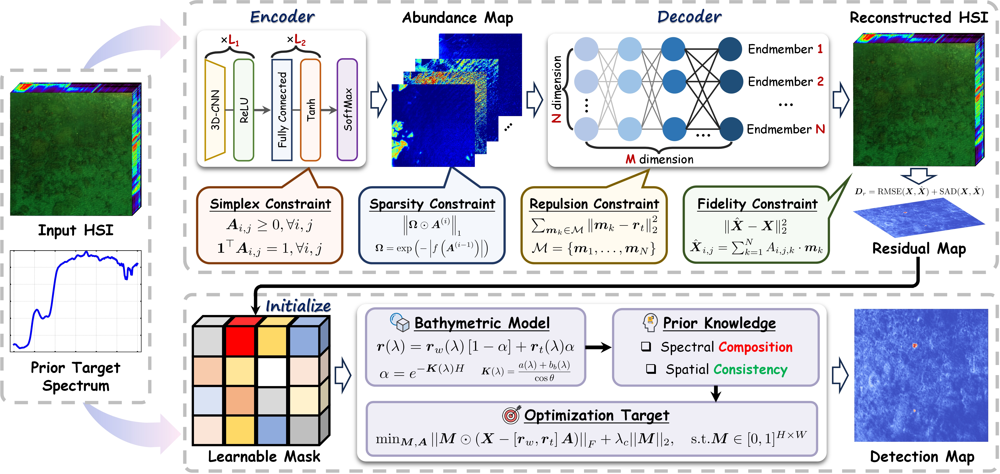

# R$^{3}$Net: Rejection-Guided Residual Reasoning for Physically Consistent Hyperspectral Underwater Target Detection

------

## 🔍 Overview

Hyperspectral underwater target detection (HUTD) is a long-standing challenge due to:

- Strong background interference
- Spectral distortions caused by water absorption and scattering
- Weak and sparse responses of submerged materials

Conventional methods often rely on **target-centric strategies** (e.g., target injection), but these approaches are fundamentally limited by the **scarcity of target pixels** and the **absence of physical constraints**, leading to unreliable detections.

To address these challenges, we propose **R$^{3}$Net**, a novel **rejection-guided residual reasoning framework**, together with a new benchmark dataset **ATR2-HUTD**.

------

## ✨ Key Contributions

- **Rejection-Guided Reconstruction**
   Suppresses target contributions to construct a background-oriented representation, with residuals naturally highlighting candidate targets.
- **Physics-Aware Residual Reasoning**
   Refines residuals under the underwater imaging model, ensuring both detection reliability and physical interpretability.
- **ATR2-HUTD Dataset**
   A large-scale UAV-borne dataset featuring:
  - Multiple aquatic environments: lake, river, coastal sea
  - Varied submersion depths and bottom substrates
  - Diverse target materials (metal, wood, plastic)
     Providing a realistic and challenging benchmark for underwater hyperspectral detection.

------

- ## 🏗️ Framework

  <p align="center">    </p> <p align="center"><i>Overall architecture of R<sup>3</sup>Net</i></p>

------

## 📂 Code and Data Availability

- **Dataset**: ATR2-HUTD is available at [BaiDuYun link](https://pan.baidu.com/s/1bhDyOUELXLKf85y_NT-smw?pwd=s45g) (Password: `s45g`).
- **Code**: The implementation of R$^{3}$Net will be made publicly available **upon acceptance of the paper**.

------

## 📑 Citation

If you find this work useful, please cite our paper:

```

```

------

## 📬 Contact

For questions or collaborations, please contact:
 📧 qijiahao1996@nudt.edu.cn